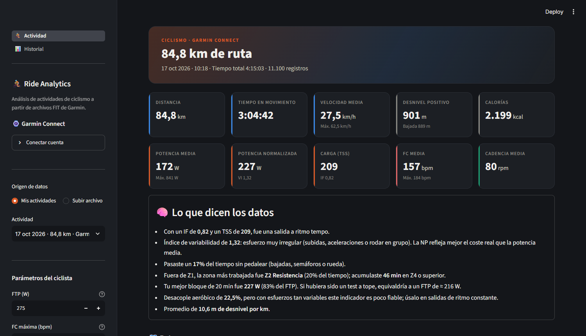
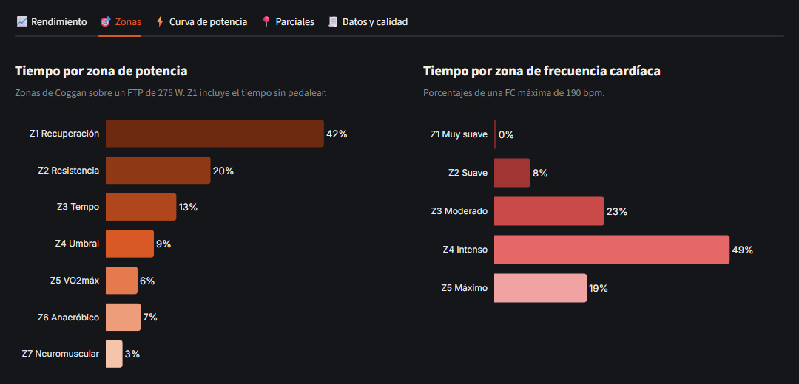
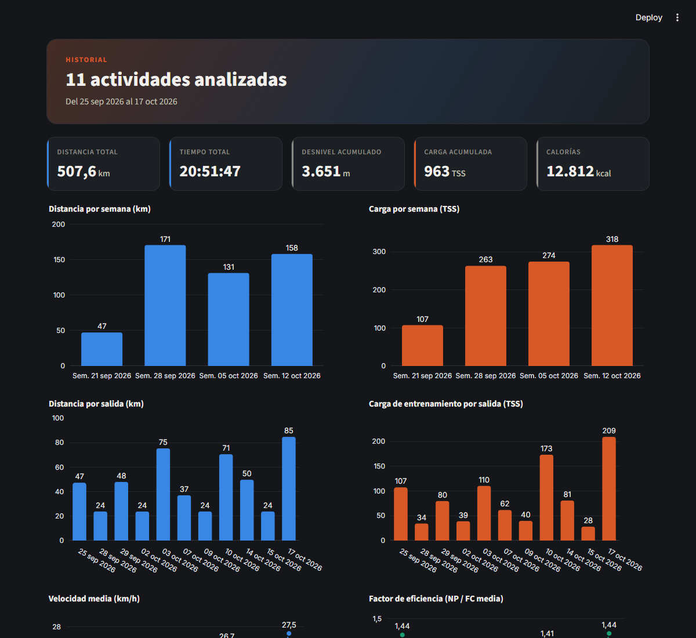

# 🚴 Ride Analytics — Dashboard de ciclismo con datos de Garmin

Dashboard interactivo que transforma los archivos `.fit` de un ciclocomputador Garmin en métricas de rendimiento, visualizaciones y conclusiones automáticas. Lo construí para analizar mis propias salidas y responder preguntas como *¿qué tan intensa fue esta salida?*, *¿en qué zonas entrené?* o *¿estoy mejorando mi eficiencia aeróbica?*



## ¿Qué hace?

| Sección | Qué muestra |
|---|---|
| **KPIs** | Distancia, tiempo en movimiento, velocidad, desnivel, potencia media y normalizada, TSS, FC y cadencia |
| **Lo que dicen los datos** | Conclusiones generadas automáticamente a partir de las métricas (intensidad, variabilidad, tiempo sin pedalear, fatiga) |
| **Ruta** | Mapa interactivo con el trazado coloreado por velocidad, potencia, FC o altitud |
| **Rendimiento** | Altitud, velocidad, potencia, FC y cadencia alineadas por distancia (*small multiples*, sin gráficos de doble eje) |
| **Zonas** | Distribución del tiempo en zonas de potencia (Coggan) y de frecuencia cardíaca |
| **Curva de potencia** | Mejor potencia sostenida de 5 s a 2 h |
| **Parciales** | Velocidad, potencia, FC y desnivel cada 1, 5 o 10 km |
| **Datos y calidad** | Validación de los cálculos contra el dispositivo, % de datos faltantes y exportación a CSV |
| **Historial** | Comparación entre actividades: distancia, carga, velocidad y factor de eficiencia |




## Sincronización con Garmin Connect

El dashboard descarga automáticamente las salidas desde **Garmin Connect** y analiza la temporada actual: **del 25 de septiembre de 2026 en adelante** (la fecha está en `SYNC_START`, en `src/ingestion/garmin_sync.py`). Las actividades anteriores no se muestran; la subida manual de un `.fit` desde la barra lateral sigue funcionando para cualquier fecha.

- **Archivo original:** se descarga el FIT tal como lo grabó el dispositivo, así que todo el análisis y la validación funcionan igual que con un archivo copiado a mano.
- **Sincronización incremental:** al abrir el dashboard (si pasaron más de 15 min) o con *Sincronizar ahora*. Solo se descarga lo nuevo, revisando además la última semana por si alguna salida se subió con retraso.
- **Tolerante a fallos:** las actividades se procesan en orden cronológico y se guardan una a una. Si Garmin limita las peticiones o se corta la red, la siguiente sincronización continúa donde quedó y el dashboard sigue funcionando con lo que ya tiene.
- **Credenciales:** la contraseña solo se usa para el primer inicio de sesión y no se guarda. Se guardan los tokens de sesión en `.secrets/` (excluido de git). Soporta verificación en dos pasos.

Para conectarla, abre *⌚ Garmin Connect → Conectar cuenta* en la barra lateral. También se puede sincronizar (e iniciar sesión la primera vez) desde la terminal:

```bash
python scripts/sync_garmin.py
```

> Usa [`garminconnect`](https://github.com/cyberjunky/python-garminconnect), una librería no oficial: si Garmin cambia su sistema de acceso puede dejar de funcionar temporalmente. La carga manual de archivos `.fit` sigue disponible como respaldo.

## Métricas calculadas

Todas las métricas avanzadas se calculan **desde los datos crudos segundo a segundo** (no se copian del resumen de Garmin):

- **Potencia normalizada (NP):** media móvil de 30 s → potencia a la 4ª → media → raíz 4ª. Pondera más los esfuerzos intensos que la potencia media.
- **Intensity Factor (IF)** = NP / FTP, y **Training Stress Score (TSS)** = duración × NP × IF / (FTP × 3600) × 100.
- **Índice de variabilidad (VI)** = NP / potencia media. Indica qué tan constante fue el esfuerzo.
- **Factor de eficiencia (EF)** = NP / FC media. Mide los vatios producidos por latido.
- **Desacople aeróbico (Pw:HR):** caída de la relación potencia/FC entre la primera y la segunda mitad.
- **Curva de potencia:** máximo de la media móvil para cada duración.

### Validación

Mis cálculos se comparan con los que hace el propio Garmin en cada salida de la temporada:

- **Potencia normalizada:** coincide **exactamente en las 11 salidas**. Al investigar una pequeña diferencia sistemática encontré dos causas: los cortes del sensor de potencia deben excluirse (no son 0 W) y Garmin muestra la NP **redondeada hacia arriba**.
- **TSS:** dentro de ±1,2 % en casi todas las salidas. Garmin lo calcula con sus valores internos (NP sin redondear y su propia duración), así que se acepta hasta un 3 %.

| Salida | NP calculada | NP Garmin | TSS calculado | TSS Garmin |
|---|---|---|---|---|
| 25 sep | 202,3 W | 203 W | 107,4 | 107,7 |
| 28 sep | 161,0 W | 161 W | 34,4 | 34,3 |
| 29 sep | 171,7 W | 172 W | 79,7 | 77,9 |
| 02 oct | 168,2 W | 169 W | 38,9 | 39,0 |
| 03 oct | 162,2 W | 163 W | 110,2 | 111,0 |
| 07 oct | 165,1 W | 166 W | 61,6 | 62,3 |
| 09 oct | 175,1 W | 176 W | 39,7 | 39,4 |
| 10 oct | 222,6 W | 223 W | 173,1 | 173,2 |
| 14 oct | 168,2 W | 169 W | 80,7 | 81,2 |
| 15 oct | 141,4 W | 142 W | 28,0 | 27,9 |
| 17 oct | 226,7 W | 227 W | 209,2 | 209,3 |

Esta comparación corre como test automático sobre cada archivo (`tests/test_ingestion_metrics.py`).

## Arquitectura

El proyecto sigue un pipeline de datos en capas: cada capa tiene una única responsabilidad y la lógica de análisis no depende de Streamlit, por lo que se puede testear por separado.

```
archivo .fit
   │
   ▼
src/ingestion/      fit_loader.py   → Lee el FIT, convierte unidades (semicírculos → grados,
   │                                  m/s → km/h), ajusta la hora UTC a hora local
   │                garmin_sync.py  → Descarga incremental de los FIT desde Garmin Connect
   ▼
src/processing/     metrics.py      → Resumen de la sesión (tolerante a sensores faltantes)
   │                performance.py  → NP, IF, TSS, zonas, curva de potencia, parciales
   │                insights.py     → Conclusiones en lenguaje natural
   ▼
src/visualization/  charts.py       → Gráficos Plotly
   │                maps.py         → Mapa Folium coloreado por métrica
   │                theme.py        → Paleta de colores y estilo compartido
   ▼
app/                streamlit_app.py → Navegación
                    views/           → Páginas "Actividad" e "Historial"
```

```
dashboard-bike/
├── app/
│   ├── streamlit_app.py
│   └── views/
│       ├── actividad.py
│       └── resumen.py
├── src/
│   ├── ingestion/fit_loader.py
│   ├── processing/{metrics,performance,insights}.py
│   ├── visualization/{charts,maps,theme}.py
│   └── ui/                      ← Tarjetas KPI, estilos, carga con caché y panel de Garmin
├── scripts/sync_garmin.py       ← Sincronización desde la terminal
├── tests/
├── data/raw/fit/                ← Archivos .fit
├── .streamlit/config.toml       ← Tema oscuro
└── requirements.txt
```

### Decisiones técnicas

- **Valores faltantes como `None`, no como `0`:** así "sin medidor de potencia" no se confunde con "0 W", y la interfaz muestra "—".
- **Caché (`st.cache_data`):** cada archivo se lee una sola vez. La fecha de modificación forma parte de la clave, así que un archivo que cambia se vuelve a leer.
- **Small multiples en lugar de doble eje:** cada métrica tiene su propia escala, alineadas por distancia.
- **Hora local:** los FIT guardan la hora en UTC; el desfase se obtiene del mensaje `activity` del propio archivo.
- **Reducción de puntos en el mapa:** máximo 4.000 puntos, para que cargue rápido sin perder la forma de la ruta.

## Cómo ejecutarlo

```bash
python -m venv .venv
.venv\Scripts\activate          # Windows  (macOS/Linux: source .venv/bin/activate)
pip install -r requirements.txt

streamlit run app/streamlit_app.py
```

Coloca tus archivos `.fit` en `data/raw/fit/` o súbelos desde la barra lateral. Puedes exportarlos desde Garmin Connect: *Actividad → ⚙️ → Exportar original*.

> Las actividades no están incluidas en el repositorio porque contienen datos GPS personales.

### Tests

```bash
pytest
```

La validación contra Garmin se ejecuta solo si hay archivos `.fit` en `data/raw/fit/`; si no los hay, esos tests se omiten.

## Tecnologías

Python · pandas · NumPy · Streamlit · Plotly · Folium · fitparse · garminconnect · pytest

## Próximos pasos

- Carga crónica y aguda (CTL / ATL / TSB) para modelar la forma física en el tiempo.
- Detección automática de subidas y cálculo de VAM.
- Tarea programada para sincronizar Garmin sin abrir el dashboard.
